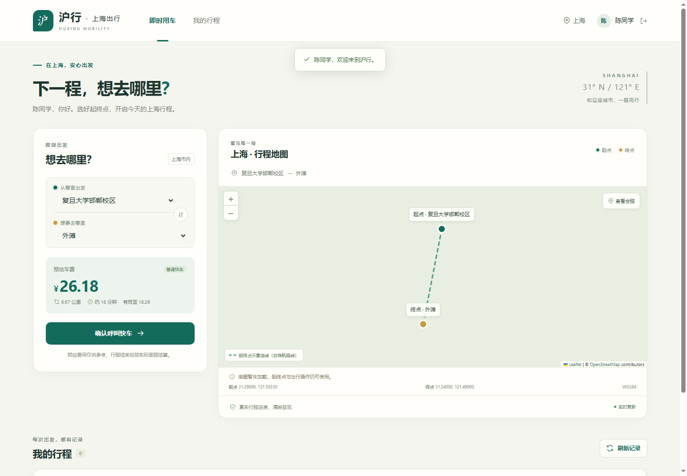
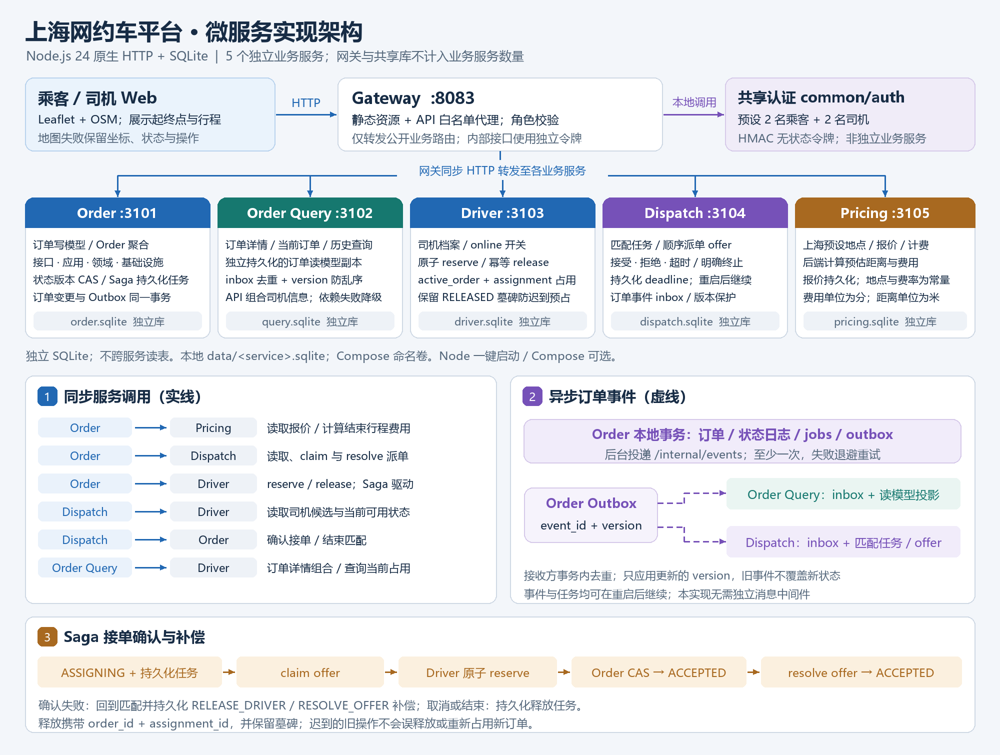

# 沪行 · 上海网约车微服务（Lab 3）

高级软件工程第 32 组 Lab 3。按[实验说明](https://openmsg.yuque.com/openmsg/gp3cfs/kyho3e4luti0xo6a)实现从叫车到结束的完整流程，交付 **5 个独立后端业务服务**、双角色网页、DDD 订单核心、CQRS、API 组合、可恢复的跨服务事务与两级自动化测试。

**本地只需 Node.js 24+，无需安装 npm 包、数据库服务或消息中间件。** 每个服务独占一个 SQLite 文件，所有跨服务访问均通过真实 HTTP。另提供 Docker Compose。

2026-11-23 复核：**77 项自动化测试通过、11 组真实服务协作验收通过**。2026-11-15 的 7 组真浏览器检查记录和截图保留，本次未重跑浏览器检查。已保存[作业要求快照](docs/assignment.txt)，新增结果见[复核记录](docs/validation.md#6-2026-11-23-代码复核与增量验证)。



## 1. 小组与分工安排

沿用 Lab 2 第 32 组。下表为本实验的分工安排与验收范围，提交前由组员核对。分工安排不代表个人 Git 提交记录。

| 成员 | 学号 | 负责范围 |
| --- | --- | --- |
| 陈星岩 | 26113050014 | Order 领域与应用层、司机与派单协作、Saga / Outbox、部署和并发恢复验收 |
| 李思源 | 26213050248 | Order Query 基础功能与 API 组合、计价服务、双角色前端与地图、业务功能测试 |
| 李金正 | 26113050066 | 公共 HTTP 与输入校验、订单事件契约及消费校验、查询降级与多订单恢复修复、边界与异常回归测试、服务联调验收及报告修订 |

## 2. 快速开始

在本目录打开终端，执行：

```powershell
node --version                # 需 v24 或更新版本
node scripts/dev.mjs
```

浏览器打开 **http://localhost:8083**。脚本启动 6 个不同的 Node 进程：5 个业务服务和 1 个网关。无需执行 `npm install`。如已安装 npm，也可使用 `npm start`。

推荐打开两个独立标签页：一个选乘客，一个选司机。身份保存在各标签页的 `sessionStorage`，互不覆盖。司机先“开启接单”，再由乘客选择地点、确认叫车；司机依次点击“接受派单 → 已到达上车点 → 乘客已上车 → 结束行程”。

关闭终端或按 **Ctrl+C** 停止本次启动的服务，数据库保留。重新执行同一命令继续使用。Node 启动脚本不会改动系统服务。

### 演示账号和初始化数据

| 账号 | 角色 | 显示名 | 初始状态 |
| --- | --- | --- | --- |
| `rider-1` | 乘客 | 陈同学 | 无进行中订单 |
| `rider-2` | 乘客 | 李同学 | 无进行中订单 |
| `driver-1` | 司机 | 王师傅 | 离线、空闲，沪A·L3101 / 白色大众朗逸 |
| `driver-2` | 司机 | 赵师傅 | 离线、空闲，沪B·L3102 / 银色别克英朗 |

账号为预设演示身份，无需密码；后端签发并校验 HMAC 令牌，业务接口仍检查角色和订单 / 派单归属。初始化使用 `INSERT OR IGNORE`，重启不会覆盖已有司机状态。若保留了此前演示的数据，以当前数据库为准；需要全新演示时按第 7 节重置。

地点：复旦大学邯郸校区、上海站、外滩、人民广场、虹桥站、徐家汇，全部使用 WGS84。报价有效 5 分钟；12 元含 3 公里，超出部分 2.5 元 / 公里，金额存为整数分。预估距离为球面直线距离 × 1.3，明确属于估计，未使用真实道路导航。结束行程默认使用预估里程，也可输入模拟实际里程（1 米至 200 公里）。

### 可选配置

```powershell
Copy-Item .env.example .env
node scripts/dev.mjs
```

| 配置项 | 默认值 | 作用 |
| --- | --- | --- |
| `GATEWAY_PORT` | `8083` | 网页与统一 API 入口 |
| `ORDER_PORT` / `QUERY_PORT` | `3101` / `3102` | 订单写服务、订单查询服务 |
| `DRIVER_PORT` / `DISPATCH_PORT` / `PRICING_PORT` | `3103` / `3104` / `3105` | 司机、派单、计价服务 |
| `HOST` | `127.0.0.1` | 本地服务监听地址 |
| `DATA_DIR` | `data` | 本地各服务数据库目录 |
| `OFFER_TTL_MS` | `15000` | 单个派单响应期限 |
| `DISPATCH_WAIT_MS` | `45000` | 一次订单匹配总期限 |
| `DISPATCH_TICK_MS` | `300` | 派单后台检查间隔 |
| `AUTH_SECRET` / `INTERNAL_TOKEN` | 公开演示值 | 简化身份签名、服务内部调用认证；所有进程需一致 |

实际 `.env` 被 Git 和 Docker 构建忽略。直接启动单个服务时可设置 `PORT`、`DB_PATH`、`ORDER_URL`、`QUERY_URL`、`DRIVER_URL`、`DISPATCH_URL`、`PRICING_URL`；完整启动脚本会根据端口自动设置服务地址。示例值仅用于本地课程演示，没有提交地图 Key 或实际凭据。

## 3. 服务与数据边界

| 服务 | 默认端口 | 自有数据库 / 数据 | 主要职责 |
| --- | --- | --- | --- |
| Order | 3101 | `order.sqlite`：orders / requests / state_log / jobs / outbox | 订单写模型、聚合规则、接单恢复与事件投递 |
| Order Query | 3102 | `query.sqlite`：order_views / inbox | 异步读模型、详情 / 当前 / 历史查询，API 组合司机资料 |
| Driver | 3103 | `driver.sqlite`：drivers / reservations | 司机档案、接单开关、独占资源与释放墓碑 |
| Dispatch | 3104 | `dispatch.sqlite`：dispatch_tasks / offers / dispatch_inbox | 顺序派单、拒绝、超时、持久化期限与派单确认 |
| Pricing | 3105 | `pricing.sqlite`：estimates | 预设地点、报价持久化、后端里程计费 |
| Gateway | 8083 | 无业务数据库 | 静态页面、演示登录、公开路由白名单代理 |

5 个业务服务均可独立运行，例如：

```powershell
node services/driver/main.mjs
```

各服务都提供 `GET /health`。业务服务不直接读取另一个服务的数据库，网关和共用工具库不计入业务服务数量。每服务每数据库使用单实例，面向课程单节点演示，不宣称达到 Lab 2 的生产峰值容量。



## 4. 自动化测试与证据

本仓库使用 Node 自带 `node:test` 与 `assert`。测试无需启动本地演示平台，组件测试在 `.runtime/tests/case-*` 下创建独立数据库，服务调用用 Stub 隔离。

```powershell
# 单元级：领域聚合与应用层，隔离仓储和外部依赖
node --test --test-isolation=none tests/order.unit.test.mjs tests/frontend.unit.test.mjs

# 服务级：真实 HTTP、SQLite、事务回滚与持久化，外部服务可模拟
node --test --test-isolation=none tests/*.component.test.mjs services/*/*.test.mjs

# 两级全部测试
npm test

# 真实服务 RPC + 故障注入验收，无需先启动整个平台
node scripts/acceptance.mjs

# 源码语法与必要交付物检查
node scripts/check.mjs
```

`--test-isolation=none` 让测试在同一测试进程加载，避免部分 Windows 沙箱禁止测试子进程管道；每个用例仍独立创建数据库 / 服务并关闭，不复用业务数据。测试不依赖执行顺序。

实际测试结果与范围见 [验证记录](docs/validation.md)，原始证据见：

- [自动化测试日志](docs/evidence/tests.tap)：含单元、Order / Query 组件、Driver / Dispatch / Pricing 测试断言。
- [2026-11-23 增量复核证据](docs/validation.md#6-2026-11-23-代码复核与增量验证)：77 项测试和 11 组真实服务验收，包含 HTTP 分包、事件校验及查询降级回归。
- [11 组服务集成验收](docs/evidence/acceptance.json)及[完整业务日志](docs/evidence/acceptance.log)：真实 HTTP、独立数据库；覆盖竞争、权限、拒单、超时、服务重启、响应丢失和失败恢复。
- [真实浏览器结果](docs/evidence/browser.json)：双角色操作、刷新恢复、无底图降级、390px 布局和 JavaScript 异常检查。
- [独立进程与健康状态](docs/evidence/runtime.json)：一键启动后实际采集，PID 与时间只代表当次运行。

可选浏览器验收需本机 Edge 或兼容 Chrome、已启动本地应用：

```powershell
# Windows 默认查找 Edge；其他环境通过 BROWSER_PATH 指定 Chromium 可执行文件
node scripts/browser-smoke.mjs
```

该脚本操作自己的演示账号并生成截图，建议在独立演示数据上运行。受限沙箱可能需要允许浏览器的进程间通信；此限制不影响后端测试。

## 5. Docker Compose 方式

安装 Docker Engine / Desktop 与 Compose v2 后：

```powershell
docker compose config --quiet
docker compose up -d --build
docker compose ps
docker compose logs -f order dispatch
```

浏览器仍访问 **http://localhost:8083**。统一 Node 24 镜像包含源代码与本地 Leaflet 资源，无 npm 安装阶段；每个业务服务独立容器、独立命名卷。容器内使用服务名访问依赖，不使用宿主机 `localhost`。网关是唯一发布到宿主机的容器。

```powershell
docker compose restart            # 重启后数据保留
docker compose down               # 删除容器，保留五个命名卷
```

本次已验证 Compose 配置可解析；由于开发环境 Docker 引擎未运行，容器构建与容器内运行未实测。本地 Node 一键启动与全部业务流程已实际验证，满足作业的“Docker Compose 或等价的一键启动方式”。

## 6. 关键规则与使用提示

- 每名乘客最多一个进行中订单。创建使用 `Idempotency-Key`；超时重试沿用同一标识，取消后重新叫车使用新的标识。
- 派单按司机 ID 顺序逐一邀请，每名司机在同一订单仅邀请一次。无人可用立即失败，全部拒绝 / 超时后结束匹配，且总期限不超过 45 秒；依赖服务故障时保留进度并等待重试。
- 司机在派单后下线，会在 Driver 最终占用时被拒绝；忙时下线不会解除当前订单，仍可到达 / 上车 / 完成。
- 乘客在上车前可取消，包括已接单、已到达阶段；开始后返回 `409 TRIP_ALREADY_STARTED`。
- 取消 / 结束确认后，释放占用可能短暂滞后。系统保存恢复任务自动重试，保留旧单释放标识，不会误释放新订单。
- 订单查询异步更新。操作成功先显示写服务确认结果与“已保存，正在同步”，后续查询追上版本后清除此提示，旧查询不会覆盖更新状态。
- 司机资料服务不可用时，订单详情返回 `partial=true` 与说明，订单本身仍可查看。
- Leaflet 已随源码提供。底图来自 OpenStreetMap，有可见署名；屏蔽底图时仍保留标记、连线、坐标和业务操作。连线仅为起终点示意，不代表导航路线。

## 7. 数据重置、诊断和故障演示

本地重置会删除业务数据库，需要先停止一键启动的服务：

```powershell
node scripts/reset.mjs --yes
node scripts/dev.mjs
```

脚本只删除项目内数据目录下五个已知数据库及 WAL / SHM 文件，检测服务正在运行时拒绝重置。独立测试与验收数据库在被忽略的 `.runtime` 目录，不会修改演示数据。

Compose 重置方式会删除本实验全部五个业务数据卷：

```powershell
docker compose down --volumes
```

运行诊断：

```powershell
node scripts/diagnose.mjs
node scripts/diagnose.mjs --save
```

每次状态修改、后台恢复和事件投影输出结构化 JSON 日志，以 `order_id` 关联。Order 的内部诊断接口列出未完成任务、未投递事件、重试次数与末次错误，只允许内部认证访问，不经过网关公开。

现场演示的账号、操作顺序、故障恢复场景与预期结果见 [报告第六节](docs/report.md#六现场验证与演示脚本)。严格竞争与丢失响应可直接运行验收脚本，有断言验证最终数据库状态。

## 8. 仓库索引与提交

```text
lab3-rideshare/
├── README.md / package.json / .env.example
├── compose.yaml / Dockerfile
├── common/                    # HTTP、SQLite、简化认证、配置
├── services/
│   ├── order/                 # interfaces / application / domain / infrastructure
│   ├── query/                 # 独立 CQRS 投影与 API 组合
│   ├── driver/ dispatch/ pricing/
│   └── gateway/               # 统一网页与公开接口入口
├── frontend/                  # 双角色原生页面 + 本地 Leaflet
├── tests/                     # Order 单元及 Order / Query 组件测试
├── contracts/                 # OpenAPI JSON 与内部事件/事务契约
├── scripts/                   # 一键启动、验收、诊断、重置、绘图
└── docs/
    ├── report.md / validation.md
    ├── architecture.png / data-model.png
    ├── images/                # 实际浏览器截图
    └── evidence/              # 实际执行记录
```

[完整实验报告](docs/report.md)按作业前五部分组织，说明 Lab 2 设计调整、DDD 调用链、CQRS、事务和五类挑战。[公开 API 契约](contracts/openapi.json)与[内部调用 / 事件契约](contracts/internal.md)以当前实现为准。

本目录为新的独立 Lab 3 Git 仓库，未改动 Lab 1 / Lab 2。提交时在课程原 CodeArts 项目下新建 lab3 仓库，再将本地内容推送到该仓库。当前交付为本地成果，未代替组员在 CodeArts 创建远程仓库或执行在线提交。

Leaflet 1.9.4 使用 BSD-2-Clause，许可证随 [vendor 资源](frontend/vendor/leaflet/LICENSE)提供。重绘两张设计图需 Python、Pillow 和中文字体；运行应用与后端测试不需要 Python。
