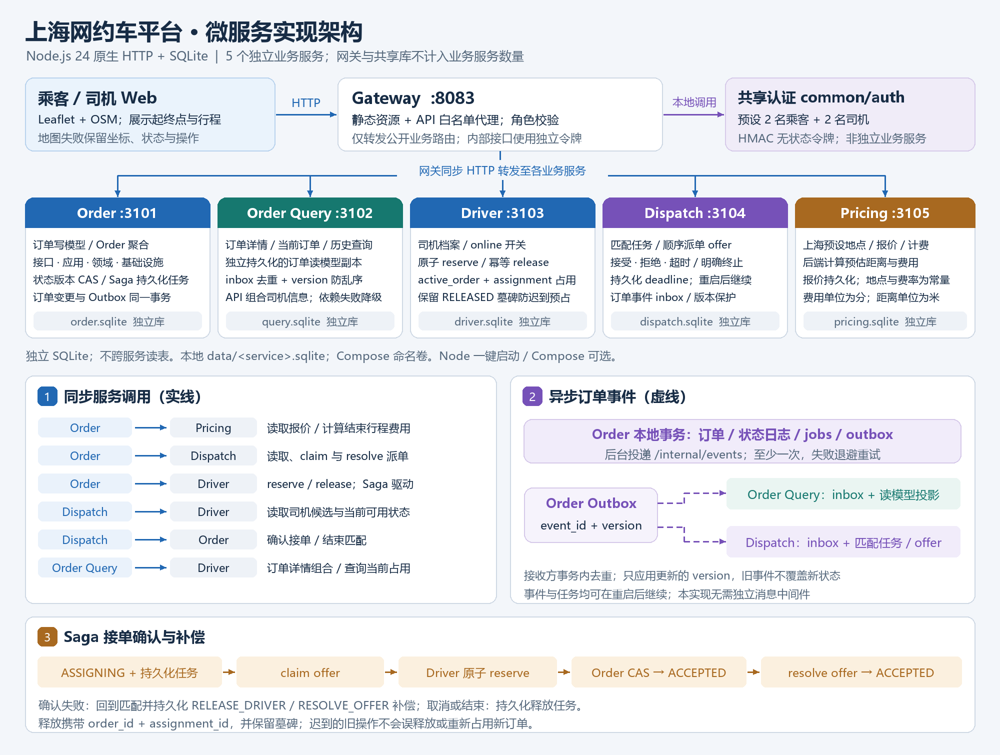
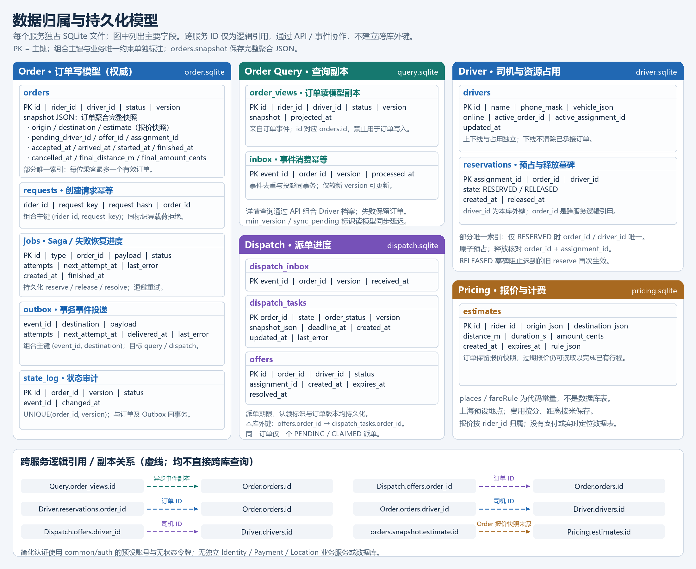
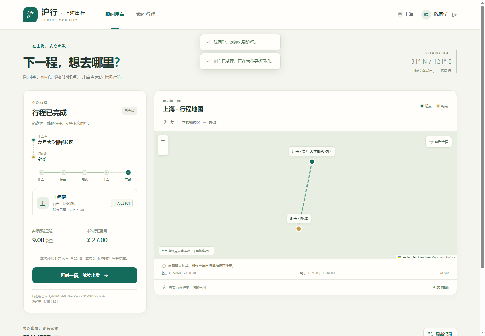
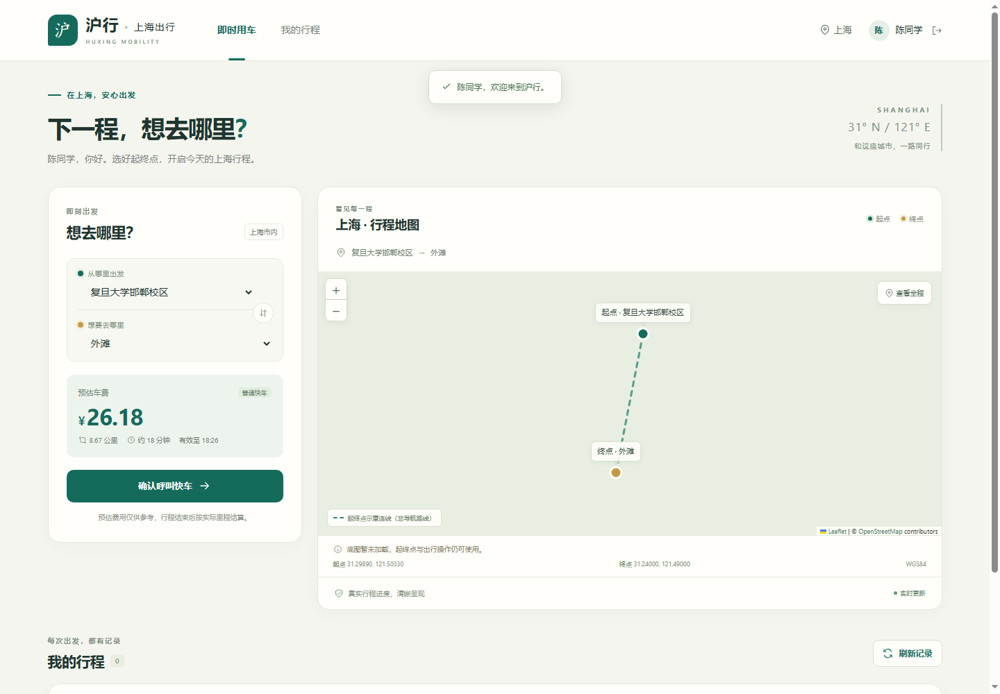

# Lab 3：网约车平台的微服务开发报告

> 课程：高级软件工程；小组：第 32 组。
> 成员：陈星岩（26113050014）、李思源（26213050248）。
> 系统名称：沪行；实现范围：上海单城；证据日期：2026-11-15。

本报告对应[作业原文](https://openmsg.yuque.com/openmsg/gp3cfs/kyho3e4luti0xo6a)前五部分，补充可重复的现场演示步骤。实现以本仓库代码、数据库约束和保存的执行结果为准。
允许简化的账号、地点、里程和费率采用预设或测试数据；订单状态、HTTP 服务调用、事件投递、读模型更新和失败恢复均有实际实现。

## 设计衔接、成员安排与验证范围

### 与 Lab2 的主要调整

Lab2 的设计基线包含九个业务服务、上海/杭州/南京三城、Kafka 事件和内部 gRPC，并提出高峰容量目标。本实验按当前作业收敛业务范围，没有把这些设计目标当作已完成的性能指标。
保留的原则是订单状态单点权威、运力与派单分离、计价独立、数据归属清晰，以及通过事件维护查询副本。

| Lab2 设计 | Lab3 实际调整 | 原因与落实位置 |
| --- | --- | --- |
| `trip-service` 管行程及面客进度 | Order 管写模型，Order Query 独立管订单读模型与组合查询 | 明确落实作业 CQRS 要求；见[订单入口](../services/order/service.mjs)与[查询服务](../services/query/service.mjs) |
| 九个业务服务、两个接入组件 | 五个业务服务和一个静态资源/API 网关 | 保留 Order、Order Query、Driver、Dispatch、Pricing，满足至少四个业务服务的要求 |
| 多城市、附近司机、扩圈、多轮邀请 | 上海预设地点；按司机 ID 排序、依次派单，每订单每司机至多尝试一次 | 不依赖真实车辆定位；[Dispatch.step](../services/dispatch/service.mjs)实现确定性策略 |
| 单邀请 15 秒、整体 180 秒 | 默认单 offer 15 秒、整体匹配 45 秒 | 缩短课堂演示等待；期限持久化，不因重启重新计时 |
| Kafka + gRPC + 多种外部基础设施 | 原生 HTTP/JSON + 持久化 Outbox HTTP 投递 + 每服务 SQLite | 降低运行依赖，同时真实保留异步事件、至少一次投递和消费幂等 |
| 支付、账单、动态调价、取消费 | 固定报价/计费规则；结束行程记录费用摘要；无支付和取消费 | 当前作业明确允许省略支付；不能将费用摘要表述为真实扣款 |
| Identity、通知、位置、运营独立服务 | 预设身份与共享 HMAC 认证；前端轮询；无真实 GPS、运营后台或通知渠道 | 集中完成核心业务与恢复机制；这些共享组件不计入业务微服务数量 |
| `trip_id` / `quote_id` / `invite_id` | `order_id` / `estimate_id` / `offer_id`，新增 `assignment_id` | 分别标识订单、报价、派单和一次司机绑定尝试，隔离迟到操作 |
| 行程结束后待支付、支付成功终态 | `COMPLETED` 直接作为完成终态 | 本实验不引入支付状态；取消和匹配失败分别为 `CANCELLED`、`FAILED` |

架构和数据图已按本次实现重新绘制，见第二部分；没有把 Lab2 的位置、支付或 Kafka 组件保留为已实现节点。

### 分工安排与记录口径

| 成员 | 建议分工安排（待组员核对） |
| --- | --- |
| 陈星岩（26113050014） | Order 领域与应用层、司机与派单协作、Saga/Outbox、部署和并发恢复验收 |
| 李思源（26213050248） | Order Query/API 组合、计价、双角色前端与地图、自动化测试、契约与报告 |
| 共同核对 | Lab2 调整、服务契约、五类挑战分析、验收结果与最终提交内容 |

以上为协作安排，不是已核实的个人代码贡献或人工提交历史。最终分工应由组员核对；本报告不声明已经上传 CodeArts 或完成平台提交。

## 一、业务功能实现

### 1.1 身份与司机状态

[common/auth](../common/auth.mjs)提供四个演示账号：`rider-1` 陈同学、`rider-2` 李同学、`driver-1` 王师傅、`driver-2` 赵师傅。
网关的 `POST /api/auth/login` 根据预设账号签发 HMAC 令牌；载荷包含账号 ID 和到期时间，角色由服务端账号表确定。令牌有效期为 24 小时，没有注册、实名认证或密码找回流程。
[网关 authorize](../services/gateway/service.mjs)先校验公开路由与角色；[公共 HTTP 入口](../common/http.mjs)在业务服务再次校验令牌，领域对象/查询服务再校验订单归属。

| 操作 | 后端约束 | 主要实现 |
| --- | --- | --- |
| 乘客查看、取消订单 | `rider_id` 必须为当前乘客 | `Order.assertRider`、Query `authorize` |
| 司机处理派单 | offer 的 `driver_id` 必须为当前司机 | Dispatch 的 accept/reject 路由 |
| 司机到达、开始、结束 | 订单的 `driver_id` 必须为当前司机，且符合状态 | `Order.assertDriver` 与状态方法 |
| 内部状态修改和事件接收 | 必须携带 `X-Internal-Token` | 公共 HTTP `INTERNAL` 路由 |
| 司机上下线 | 仅司机本人可设 `online` 布尔值 | [Driver 状态入口](../services/driver/service.mjs) |

Driver 将 `online` 和订单占用分开：下线只关闭新接单资格，不清空 `active_order_id` 或 `active_assignment_id`。
因此司机忙时下线仍可完成已接订单；完成或取消后释放占用，但保留原在线开关，只有仍在线的司机可再次成为候选。

### 1.2 选点、报价、叫车与取消

[Pricing 的 places](../services/pricing/service.mjs)列出复旦大学邯郸校区、上海站、外滩、人民广场、虹桥站、徐家汇六个上海地点。
乘客从下拉框选择起终点，前端地图展示相同坐标；`POST /api/orders/estimate` 由后端生成属于当前乘客的报价。
预估距离为 WGS84 两点 Haversine 直线距离乘 1.3，四舍五入到米且至少 100 米；预估时间按 30 km/h 估算且至少 60 秒。这是估计值，不是道路规划结果。

费用规则固定为 12 元含 3 km，超出部分 2.5 元/km，金额以整数分持久化：

```text
amount_cents = 1200 + round(max(0, distance_m - 3000) * 250 / 1000)
例：9000 米 => 1200 + 1500 = 2700 分，即 27.00 元。
```

报价有效期为 5 分钟。`OrderApplication.create` 检查报价归属与有效期，再创建包含乘客、起终点及报价快照的 `MATCHING` 订单。
创建请求必须携带 8–128 位 `Idempotency-Key`；[requests 表](../services/order/infrastructure/repository.mjs)以 `(rider_id, request_key)` 去重，并核对请求摘要。
同一请求重试返回原订单；同一键改报价返回冲突；同一乘客最多存在一个有效订单。取消后新叫车使用新键与新订单 ID。

`Order.cancel` 允许在 `MATCHING`、`ASSIGNING`、`ACCEPTED`、`ARRIVED` 阶段取消，已接单或已到达均不构成禁止取消的理由。
取消先在 Order 提交权威状态和事件；已有绑定尝试时，同事务保存释放司机任务。Dispatch 收到事件后关闭派单，司机端轮询取得取消结果。
事件尚未同步时，旧 offer 即使仍短暂可见，也无法越过 Order 的终态检查重新成交。开始行程后取消返回 `409 TRIP_ALREADY_STARTED`。
释放可能因依赖暂不可用而延后；在释放完成前司机仍被占用，系统不会为提高可用性而冒险重复绑定。

### 1.3 派单与接单

[Dispatch.step](../services/dispatch/service.mjs)通过 Driver API 取得司机，筛选 `online=true` 且没有有效占用的候选，按司机 ID 排序依次派单。
每个订单对每位司机只尝试一次；`UNIQUE(order_id, driver_id)` 和已保存的 offer 历史使服务重启后仍能排除已尝试司机。
司机在有效期内接受或拒绝；拒绝或 `PENDING` 超时后换下一位。没有候选时立即结束匹配，不在本轮等待司机未来上线。

| 时限/结果 | 默认规则与持久化行为 |
| --- | --- |
| 单 offer | 15 秒；`expires_at` 不超过任务的整体 `deadline_at` |
| 整体等待 | 从订单创建时间起 45 秒；重启后继续使用原期限 |
| 无可用司机 | Order 进入 `FAILED`，原因 `NO_DRIVER` |
| 已尝试候选耗尽 | 结束匹配，原因 `ALL_REJECTED`，不循环向同一司机派单 |
| 整体到期 | 结束匹配，原因 `MATCH_TIMEOUT` |
| 已 claim、正在确认接单 | 不按普通等待超时强行撤销；由持久化 Saga 恢复确认或补偿 |

接受派单经过 Dispatch 身份/期限校验，再由 Order 发起确认，Driver 在本地事务内最终裁决在线资格与独占资源。
Order 只能从当前 `ASSIGNING` 尝试确认成 `ACCEPTED`；Driver 通过部分唯一索引保证有效预占的 `driver_id` 和 `order_id` 均唯一。
候选查询只是撮合输入，不是占用证明。派单后司机下线、被其他订单占用或 offer 过期，都可使本次确认失败。
接单成功后，乘客通过组合查询看到司机姓名、脱敏电话和车辆信息，司机通过当前订单看到起终点。

### 1.4 接驾、上车与结束行程

[Order 聚合](../services/order/domain/order.mjs)中的状态转换如下；`ASSIGNING` 用于表示跨服务确认尚未完成，不能伪装成已接单。

```text
MATCHING -> ASSIGNING -> ACCEPTED -> ARRIVED -> IN_PROGRESS -> COMPLETED
    ^           |
    +-----------+  业务性预占失败后回到匹配
MATCHING / ASSIGNING / ACCEPTED / ARRIVED -> CANCELLED
MATCHING -> FAILED
```

司机依次点击“已到达上车点”“乘客已上车，开始行程”“结束行程并计费”；这些动作模拟现场事实，不校验真实车辆距离。
`arrive`、`start`、`finish` 分别保存首次有效到达、开始与结束时间，非法跳步由后端拒绝；重复操作不重写首次有效时间或已保存的费用摘要。
结束时可输入测试里程，或沿用预估里程；后端只接受 1–200000 的整数米并调用 Pricing 计费，不采信浏览器自报金额。
乘客可看当前订单与自己的历史记录，历史详情包含起终点、司机、状态、时间和费用；司机可查看自己正在承接或确认中的订单。

## 二、DDD 四层架构与数据管理

### 2.1 独立服务与实际拓扑



| 进程 | 默认端口 | 业务职责/本地数据 |
| --- | --- | --- |
| Order | 3101 | 订单写模型、状态规则、幂等请求、Saga jobs、Outbox、状态日志 |
| Order Query | 3102 | 订单读模型、事件 inbox、当前订单/历史/组合详情 |
| Driver | 3103 | 司机/车辆档案、上下线、独占占用、预占与释放墓碑 |
| Dispatch | 3104 | 匹配任务、顺序 offer、拒单/超时、期限和消费进度 |
| Pricing | 3105 | 上海地点常量、预估报价持久化、后端费用计算 |
| Gateway | 8083 | 静态资源、简化登录、公开 API 白名单代理；不计入五个业务服务 |

各业务服务都有自己的入口和 `/health`，本地启动器会创建五个业务子进程与一个网关子进程。共享代码并不使它们共享内存或数据库。
同步协作包括 Order→Pricing 报价/计费、Order→Dispatch 读取/claim/resolve offer、Order→Driver reserve/release、Dispatch→Driver 候选查询、Dispatch→Order 确认/失败，以及 Query→Driver 查询组合。
Order→Query、Order→Dispatch 的订单事件由后台工作器异步投递；详见第三部分。
公开请求/响应见[OpenAPI 契约](../contracts/openapi.json)，内部 claim/reserve/release/resolve API、事件格式及幂等语义见[内部契约](../contracts/internal.md)。

### 2.2 Order 的 DDD 四层和聚合根

| 层 | 实际代码 | 主要职责与边界 |
| --- | --- | --- |
| 接口层 | [interfaces/routes](../services/order/interfaces/routes.mjs)的 `orderRoutes` | 将认证后的身份、路径、请求体交给应用层；区分 201/200/202，不编写订单规则 |
| 应用层 | [application/order-service](../services/order/application/order-service.mjs)的 `OrderApplication` | 编排 create/accept/cancel/finish，调用外部 API，创建并执行 Saga 任务 |
| 领域层 | [domain/order](../services/order/domain/order.mjs)的 `Order` | 聚合根，维护状态、归属、绑定尝试、首次时间、里程与费用约束 |
| 基础设施层 | [infrastructure/repository](../services/order/infrastructure/repository.mjs)及[服务组装](../services/order/service.mjs) | SQLite 事务、版本条件更新、Outbox、任务存取、HTTP 客户端和后台调度 |

`Order` 的聚合数据包含订单 ID、乘客、司机、状态、版本、地点与报价快照、当前 offer/assignment、关键时间和费用摘要。
聚合内必须满足：终态不能被迟到接单复活；仅当前 assignment 可确认；上车前可取消；先到达才能开始；仅行程中可结束；重复有效动作不重写已封存结果。
领域层不打开数据库、不调用 HTTP、不启动定时器，只依赖[纯异常模块 AppError](../common/errors.mjs)。应用层通过仓储方法和注入的 clients 编排，不直接执行 SQL；身份/时钟与日志使用纯工具模块，HTTP 和 SQLite 适配集中在接口及基础设施层。
其他服务按职责组织代码；本实验选择 Order 完成完整四层实现，没有以创建四个空目录代替领域模型。

### 2.3 关键调用链：接受派单

1. 司机请求 Dispatch 的 `POST /offers/:id/accept`；Dispatch 验证本人 offer、状态和期限，调用 Order 内部 accept API。
2. `orderRoutes` 将 `driver_id`、`offer_id` 传给 `OrderApplication.accept`；应用层读取当前订单及 Dispatch 的 offer，并生成新的 `assignment_id`。
3. `repository.change` 开启本地事务，聚合 `beginAssignment` 带入该标识，从 `MATCHING` 转为 `ASSIGNING`。
4. 同一事务更新订单版本、写状态日志及两个目标的 Outbox，并添加 `RESERVE_DRIVER` job；任一步失败则本地回滚。
5. `OrderApplication.assign` 先 claim offer，再请求 Driver 原子 reserve；此处的网络调用发生在订单本地事务之外。
6. 成功后再次进入 `repository.change`，由 `confirmAssignment` 校验 assignment 与当前状态，并条件更新为 `ACCEPTED`；保存后续 resolve job。
7. 确认条件已被取消等操作改变时不覆盖新状态，而是保存 release 补偿；业务性失败则回到匹配并保存 release/resolve 补偿。
8. 若响应丢失或依赖失败，job 保留 `PENDING`，当前请求可返回 `202 ASSIGNING`；后台及服务重启后继续相同尝试。

### 2.4 数据归属、本地事务与持久化



| 所属服务 | 表/数据 | 权威性与关联方式 |
| --- | --- | --- |
| Order | `orders`、`requests`、`jobs`、`outbox`、`state_log` | 权威订单；driver/offer/estimate ID 是跨服务引用或快照 |
| Query | `order_views`、`inbox` | `order_views` 是订单事件投影副本；不能反向修改订单 |
| Driver | `drivers`、`reservations` | 权威司机资格与占用；`RELEASED` 墓碑持久保留 |
| Dispatch | `dispatch_tasks`、`offers`、`dispatch_inbox` | 自己的撮合进度与派单；订单 JSON 是事件快照 |
| Pricing | `estimates`；代码中的 `places`、`fareRule` | 报价归 Pricing；地点和费率是代码常量，不是额外数据库表 |

本地文件分别为 `data/order.sqlite`、`query.sqlite`、`driver.sqlite`、`dispatch.sqlite`、`pricing.sqlite`，Compose 为每个业务服务配置独立命名卷。
[openDb / transaction](../common/db.mjs)启用 WAL、外键与 5 秒 busy timeout，短事务使用 `BEGIN IMMEDIATE`；服务内数据修改与必要进度一并提交。
Order 更新带 `WHERE id=? AND version=?`，并为同一乘客的有效订单建立部分唯一索引；Driver 用本地事务和有效预占唯一索引实现资源排他。
服务之间没有跨库 JOIN 或直接读写其他服务业务表。测试读取被测服务自己的数据库用于断言，不是业务服务绕过 API 访问他人数据。
浏览器 sessionStorage 只保存登录/未确认创建请求等交互上下文；订单、占用、offer、期限和恢复任务不依赖浏览器内存生存。

## 三、CQRS 与 API 组合查询

### 3.1 写模型、订单事件与读模型

Order 负责全部订单业务修改；Query 仅消费订单事实并提供查询。两者独立运行、独立持久化，没有将“同库不同路由”当作 CQRS。
[OrderRepository.emit](../services/order/infrastructure/repository.mjs)产生 `order.created.v1` / `order.changed.v1`，事件包含 `event_id`、`aggregate_id`、`version`、`occurred_at`、`trace_id` 和完整订单快照 `data`。
`aggregate_id`、`trace_id` 对应订单 ID；完整快照让较新事件先到时可直接投影，不要求先收到所有中间版本。
每个事件按 query/dispatch 目标写入 Outbox，组合主键为 `(event_id, destination)`，分别记录尝试次数、下次重试时间、投递时间和最后错误。

[Order.tick](../services/order/service.mjs)默认每 250 ms 调度到期 jobs 和 Outbox，调用各目标的 `POST /internal/events`；成功响应后才标记该目标已投递。
如果接收方已提交但应答丢失，同一个事件会再次投递，因此传输语义为“至少一次”，不宣称 HTTP 能保证恰好一次。
[Query.project](../services/query/service.mjs)在同一 SQLite 事务中以 `inbox.event_id` 去重，并仅在新版本大于 `order_views.version` 时更新快照。
Dispatch 的 `ingestEvent` 同样在 inbox 与任务/offer 修改之间建立本地事务；重复或旧版本不恢复已取消任务。

### 3.2 真实 API 组合场景

`GET /api/orders/:id` 由网关转给 Query。Query 先读取自己的 `order_views` 并验证访问者归属，再调用 Driver 的 `GET /internal/drivers/:id` 获取当前司机档案。
Query 的 `combine` 将订单、司机/车辆、投影版本、投影时间和同步/降级标记合并返回；司机信息不是浏览器硬编码，也不是 Query 跨库读取。
司机“当前订单”查询还先从 Driver 读取 `active_order_id`，再定位本地投影，避免把已释放的旧读模型误认成当前占用。

| 返回字段/状态 | 含义与前端处理 |
| --- | --- |
| `projection_version` / `projected_at` | 读模型版本及处理时间，用于判断当前可见数据 |
| `min_version` 参数 | 调用方已知的最低订单版本；投影落后时返回 202 |
| `sync_pending=true` | 读模型尚未追上已知成功操作；不谎称状态已同步 |
| `partial=true`、`DRIVER_UNAVAILABLE` | Driver 补充信息暂不可取，仍返回可用订单，司机资料为空并提示 |
| 投影尚不存在 | 携带最低版本查询时返回 202；普通未知订单返回 404 |

[前端 rememberOrder / applyMutation / applyQuery](../frontend/app.js)保留写操作返回的新版本，不让旧查询覆盖刚成功的结果，并显示“已保存，正在同步”。
前端通常每 1.2 秒轮询，操作后约 100 ms 提前查询；再次可见/网络恢复时也刷新。这里是轮询通知，不是 WebSocket 推送。
Query 短暂不可用时，网关/前端展示连接问题并保留已有进度；写模型更新不依赖查询服务在线。

## 四、自动化测试、前端与系统验证

### 4.1 两级自动化测试与执行结果

运行要求为 Node.js 24+；已保存的验收环境为 Node.js v24.21.0。应用和测试使用 Node 内置 HTTP、SQLite、assert、test，无需安装 npm 运行依赖。
可从仓库根目录执行下列命令；具体脚本定义见[package 配置](../package.json)。

```sh
npm run test:unit
npm run test:component
npm test
npm run test:e2e
```

| 层级 | 测试代码与隔离方式 | 实际验证内容 |
| --- | --- | --- |
| 单元级 | [Order unit tests](../tests/order.unit.test.mjs)；领域对象直接测试，应用层替身仓储/报价依赖 | 完整状态机、权限、允许取消阶段、迟到确认、首次时间、费用输入、创建幂等、报价归属/过期 |
| Order 服务级 | [Order component tests](../tests/order.component.test.mjs)；临时独立 SQLite 文件、真实 Order HTTP，外部 clients 替身 | 请求认证、持久化/重启、事务 Outbox、重复创建、恢复任务、响应丢失、取消竞争、回滚、取消与开始并发 |
| Query 服务级 | [Query component tests](../tests/query.component.test.mjs)；独立 SQLite 和 Query HTTP，Driver 查询替身 | 重复/乱序/跨版本投影、重启后查询、组合降级、最低版本、本人权限、无效事件回滚 |
| 其他服务级 | [Driver](../services/driver/service.test.mjs)、[Dispatch](../services/dispatch/service.test.mjs)、[Pricing](../services/pricing/service.test.mjs) | 资源竞争与墓碑、顺序派单/期限/claim/重复事件、报价与计费边界及恢复 |
| 边界回归 | [前端状态单元测试](../tests/frontend.unit.test.mjs)使用惰性 DOM 与替身 fetch；[网关组件测试](../tests/gateway.component.test.mjs)使用真实网关 HTTP 与依赖替身 | 旧投影不回退、新建重试键、接单确认中/失败、忙时下线，以及路由目标、内部接口隔离、202/409 透传和本地静态资源 |

Order 和 Query 组件测试使用[测试目录辅助函数](../tests/helpers.mjs)分配独立测试数据库，不修改本地演示数据；部分其他测试用内存库，重启案例显式使用独立文件库。
组件测试可启动被测服务及依赖替身，不要求运行整个系统。它既断言 HTTP 结果，也断言订单/Outbox/任务等持久化结果。
额外的[四个跨服务竞态回归](../services/dispatch/races.test.mjs)使用真实 Order、Driver、Dispatch、Pricing HTTP 与隔离库，并在指定调用/事件处设故障闸门；Query 事件目标在该夹具中替代，不能将此夹具描述成完整五服务端到端测试。
四个案例分别验证 ASSIGNING 先到而 claim 过期后的新 MATCHING 事件补投、预占提交后丢响应并跨期限重启、取消释放先于迟到 reserve，以及取消后迟到的成功 resolve。
事务回滚案例通过 SQLite trigger 让 Outbox 插入失败，断言此前的订单修改也回滚、事件与状态日志没有半次提交，验证订单与可靠事件同生共死。
测试使用断言判定成功，不把日志打印或 HTTP 200 单独当作业务正确的证据。

| 证据 | 本次保存的结论 | 范围说明 |
| --- | --- | --- |
| [测试 TAP 原始输出](evidence/tests.tap) | 68 项测试、68 项通过、0 失败、0 跳过 | 含核心业务、前端状态、网关及跨服务竞态回归；不据此声称压力或容量达标 |
| [HTTP 协作结果](evidence/acceptance.json)、[执行日志](evidence/acceptance.log) | 11 项 PASS、0 项 FAIL | 真实 HTTP RPC、五份独立 SQLite、包含故障注入及服务实例重启 |
| [浏览器结果](evidence/browser.json) | 7 项检查 PASS，未捕获 JavaScript 异常列表为空 | 真 Edge、两个独立浏览器会话、故意阻断 OSM 底图 |

HTTP 协作运行器[acceptance](../scripts/acceptance.mjs)在一个 Node 测试运行器中创建服务 factories，绑定不同 HTTP 端口并使用独立文件数据库；没有启动六个独立操作系统进程。
其 `pump` 显式推进工作器，并将单 offer/整体等待缩短为 800 ms/5000 ms；这只用于验证期限与恢复，不改变正常默认 15 秒/45 秒。
真实本地进程拓扑由[dev 启动器](../scripts/dev.mjs)另外验证；进程/健康记录见[运行诊断证据](evidence/runtime.json)，不能用验收运行器的多端口替代多进程证据。

### 4.2 双角色界面、地图与浏览器结果

[前端逻辑](../frontend/app.js)与[页面](../frontend/index.html)提供乘客选点/报价/叫车/取消/历史详情、司机上下线/接拒派单/到达/开始/结束。
界面根据服务返回显示状态、操作结果、错误原因和同步提示；主要权限与状态限制仍由后端实施，隐藏按钮不是唯一控制。
地图使用随仓库提供的 Leaflet 与 OpenStreetMap 瓦片，保留来源署名；本方案不需要地图 Key。前后端均使用同一组 WGS84 经纬度。
底图加载失败时，Leaflet 标记/坐标仍可用；若地图库本身不可用，显示坐标示意图。估距、报价、下单和订单流程不依赖底图请求成功。
起终点连线仅为位置示意，没有将它冒充真实道路路线、车辆轨迹或 GPS 导航。

浏览器脚本[browser-smoke](../scripts/browser-smoke.mjs)通过 Edge CDP 操作真实页面，阻断 OSM 瓦片，再完成乘客叫车、司机接单、到达、开始、9 km 结束计费及刷新历史。
该次检查还断言开始后乘客不再有普通取消按钮、刷新后保留身份并恢复持久化历史、390 px 视口无整页横向溢出，且无未捕获 JS 异常。

| 截图 | 证明的界面状态 |
| --- | --- |
| [登录页](images/login.png) | 乘客/司机预设身份入口 |
| [乘客选点与报价](images/rider-booking.png) | 起终点、估价及底图不可用提示 |
| [司机已接单](images/driver-accepted.png) | 当前承接订单与后续到达操作 |
| [乘客行程完成](images/rider-completed.png) | 后端返回完成结果和 9 km / 27.00 元费用 |
| [移动视口](images/mobile.png) | 390 px 界面及刷新后的历史入口 |



### 4.3 一键启动、配置与诊断

本地执行 `npm start`，即运行[dev 启动脚本](../scripts/dev.mjs)，为各业务入口和 Gateway 分别 spawn 子进程；浏览器访问 `http://127.0.0.1:8083`。
使用[配置示例](../.env.example)设置端口、数据目录、认证/内部令牌及派单时限；启动器加载本地 `.env` 并为子进程传入服务 URL 与独立 `DB_PATH`。
示例仅含演示值；不得提交真实密钥。默认绑定本机，当前实现用于本地课堂验证，没有把演示密钥或 HTTP 内部令牌描述为生产认证方案。
首次启动自动建表、插入两名离线司机；四个身份来自预设账号。订单、报价和派单从空数据开始。
停机后可执行 `node scripts/reset.mjs --yes`；[重置脚本](../scripts/reset.mjs)检查服务未运行及数据目录边界，只删除五个业务库及其 WAL/SHM 文件，下次启动重新初始化。

[Compose 配置](../compose.yaml)和[Dockerfile](../Dockerfile)提供可选容器启动路径：五份业务命名卷、健康检查、内部服务地址，宿主机仅暴露本机网关端口。
本次 `docker compose config --quiet` 已通过配置校验，但 Docker 引擎未启动，没有执行镜像构建或容器运行；不能将配置校验记录等同容器部署成功。
本次实际完成运行和浏览器验证的是 Node 本地路径，不要求 Kubernetes 或 CI/CD。

日志携带 `service`、`order_id`，并在相关流程保留 event/job/assignment/request 标识；`state_log` 可按订单版本查看状态轨迹。
Order 内部诊断接口可列出待执行 jobs 和待投递事件及最后错误；它不通过网关公开。Dispatch 保存任务期限、版本、offer 状态和 `last_error`。
Order 的 jobs/Outbox 失败按 250 ms 起、最高 10 秒间隔退避并继续重试；Dispatch 以默认 300 ms 周期处理保留的撮合进度。
没有自动人工告警、工单或后台重试管理界面；故障诊断依靠持久记录与日志。恢复前提是磁盘数据保留、相关依赖最终恢复。

### 4.4 对照作业的验收结果

| 作业验收项 | 已保存的实际证据与预期 |
| --- | --- |
| 完整流程 | 协作验收“完整主流程、忙时下线、费用与历史查询”及浏览器完整操作；9 km 保存 2700 分 |
| 取消与重新叫车 | “已到达后取消、重新叫车、旧接单与旧释放均无害”；新旧订单 ID 不同 |
| 无人、拒单、超时 | 三项独立协作案例；明确失败而不无限保留等待界面 |
| 重复与竞争 | Order/Driver/Dispatch 组件断言；协作验收两订单竞争同司机只有一个有效占用 |
| 权限与状态 | 组件测试本人/角色/内部接口校验，开始后取消为 409；协作验收非本人查询为 403 |
| 跨服务失败恢复 | reserve 已提交后响应丢失、查询停机补投、完成后的延迟释放均有协作恢复案例 |
| 刷新及服务重启 | Edge 刷新历史；组件及协作重启 Order/Query/Driver/Dispatch 后继续持久进度 |

## 五、关键业务挑战与处理说明

### 5.1 并发接单与司机资源竞争

两个订单可先后选中同一个仍显示空闲的候选；Dispatch 不将候选查询结果当作锁。[Driver 的 reserve 路由](../services/driver/service.mjs)在 `BEGIN IMMEDIATE` 中核对在线/占用，再写 reservation 与司机当前绑定。
有效 reservation 对 `driver_id`、`order_id` 分别有部分唯一索引，保证同一司机一份占用、一订单一名司机；Order 的版本/当前 assignment 检查进一步阻止冲突成交。
本实现顺序派单，同一订单不同时维护多份 PENDING/CLAIMED offer，因此正常流程不存在同时接受多份有效 offer 的情况。
A 超时后重派 B 时，A 的旧 offer 已过期或已变为终结态，公开 accept 与内部 claim 均拒绝它；不能仅凭订单 ID 接受任意派单。
派单后司机下线由 Driver 最终 reserve 检查捕获，Order 回到匹配并保存补偿；已成功 reserve 的重复调用即使司机随后下线，仍返回该次已提交结果。
未获资源的一方收到冲突或返回含 `last_assignment_failure` 的未成交订单，前端显示未确认而不显示接单成功。
证据：[Driver 竞争/墓碑测试](../services/driver/service.test.mjs)、[Dispatch claim/过期测试](../services/dispatch/service.test.mjs)、[协作验收](evidence/acceptance.json)的“两个订单竞争”“派单后司机下线”。

### 5.2 服务失败与业务恢复

所选跨服务事务为“接受派单”：Dispatch claim、Driver reserve、Order 确认、Dispatch resolve，由 Order 的持久化 Saga jobs 编排。
不在 HTTP 调用期间持有跨服务数据库事务；本地事务负责保存状态与下一步，网络超时不等于下游未执行。

| 失败窗口 | 实际处理与可恢复进度 |
| --- | --- |
| Driver 已占用，Order 确认前失败/重启 | 原 `RESERVE_DRIVER` job、assignment 和 `ASSIGNING` 已落盘；重试同一 claim/reserve 后继续确认 |
| 接单实际成功但应答丢失 | 用当前 offer/driver/assignment 识别重放；已成功的 reservation 幂等返回，不另建绑定 |
| 取消/结束已保存，司机释放失败 | 终态与 `RELEASE_DRIVER` job 同事务；重启扫描 PENDING 后按原绑定释放 |
| 派单等待期间重启 | Dispatch 从任务/offer 及原 deadline 恢复，不重置候选历史或等待时钟 |
| 订单已保存，事件尚未发送 | 同事务 Outbox 留存；重启后继续投递到每个未确认目标 |
| 消费提交后响应丢失/消费中退出 | 同事务 inbox+业务修改；未提交就回滚，已提交重投由 event_id 去重 |
| 业务拒绝而非临时故障 | `assign` 对明确的 400/403/404/409/410 回到匹配，保存 release 与 resolve FAILED 补偿 |
| resolve 发现派单已不存在或不属于该认领 | 对 404/409/410 结束该通知 job，不改其他认领；避免旧通知无限重试，权威订单事件继续同步状态 |

[OrderApplication.runJob/assign](../services/order/application/order-service.mjs)和[仓储重试方法](../services/order/infrastructure/repository.mjs)保存次数、下次执行时间与错误；暂时失败不会直接丢弃任务。
恢复再次失败会继续退避，间隔上限 10 秒，尝试次数不封顶；没有自动人工介入能力，长期不可用需要查看诊断记录后处理环境问题。
证据：[Order lost-response/restart/rollback 组件案例](../tests/order.component.test.mjs)、[跨服务竞态回归](../services/dispatch/races.test.mjs)与[协作验收](evidence/acceptance.json)的后三个恢复案例；故障代理只存在于验收脚本，不加入正常服务路由。

### 5.3 取消、接单与开始行程之间的竞争

取消和接单确认都在 Order 的短事务中重新读取聚合并按版本修改，迟到的 `confirmAssignment` 必须同时匹配状态与 assignment。
取消先于确认提交时，订单保持 `CANCELLED`，迟到 reserve/确认触发释放，不会重新变为 ACCEPTED；先完成接单时，乘客仍可在开始前合法取消。
取消与开始同时发生时，由 Order 最先提交的合法状态变更决定结果：取消先提交则 start 返回 409；开始先提交则 cancel 返回 `TRIP_ALREADY_STARTED`。
后一种情形保留首次 `started_at`，前一种情形不写入开始时间；两方通过操作响应及随后版本投影看到最终结果。
这不是“接单与取消二者只能一个成功”：接单成功以后、尚未上车仍可接着取消，符合题目规则。
证据：[Order 组件测试](../tests/order.component.test.mjs)的“cancelling while reservation is in flight”和“concurrent cancel and start”、[领域取消阶段测试](../tests/order.unit.test.mjs)，以及[真实跨服务竞态测试](../services/dispatch/races.test.mjs)中释放先到、迟到 resolve 的两个案例。

### 5.4 重复请求、重复事件与乱序更新

| 重复/迟到输入 | 标识与防护 | 对应验证 |
| --- | --- | --- |
| 创建响应丢失、连续点击叫车 | 前端保留同一请求键；后端 requests 主键与请求摘要；乘客有效订单唯一索引兜底 | Order unit/component 创建重放、键冲突、取消后新键 |
| 重复接单、开始、结束 | 当前 offer/assignment 识别接单；聚合检查首次时间/终态；重复结束返回原费用摘要 | Order 生命周期、重复时间与计费断言 |
| 同一事件反复投递 | 接收方 inbox 主键与投影/任务修改同事务 | Query、Dispatch 重复事件测试 |
| 旧版本晚于新版本 | 只接受严格更大 version；全量快照可跳过中间版本 | Query 先行程中后旧事件、Dispatch 取消后旧事件 |
| 旧单接受/释放晚到新单之后 | 旧 offer 失效；release 同时匹配 order_id 和 assignment_id；RELEASED 墓碑拒绝旧 reserve | Driver 重启墓碑测试、协作“旧接单与旧释放均无害” |

取消后重新叫车是新操作，而不是复用旧幂等键；新订单生成新 assignment，旧请求不能解除新订单的司机占用。
去重记录和业务效果同事务，避免“记录已消费但业务未改”或“业务已改却无幂等记录”的本地提交窗口。
“至少一次投递 + 幂等业务效果”不等于网络层恰好一次；外部调用也可能重试，但持久业务结果不会重复绑定或重复封存费用。
测试入口：[Order unit](../tests/order.unit.test.mjs)、[Order component](../tests/order.component.test.mjs)、[Query component](../tests/query.component.test.mjs)、[Driver](../services/driver/service.test.mjs)、[Dispatch](../services/dispatch/service.test.mjs)。

### 5.5 订单查询延迟与组合查询失败

开始行程返回成功时，页面先用权威操作响应更新本地订单，并记住该版本；随后 Query 即使暂时仍显示 ACCEPTED，也不能覆盖较新的 IN_PROGRESS。
查询携带 `min_version`，读模型未追上时返回 202 与 `sync_pending`；前端展示同步提示并轮询，不把临时延迟解释成开始失败。
Query 的 Driver 依赖失败时，仍保留本地订单和操作入口，补充资料返回空并标记 `partial/warnings`；Driver 恢复后再次查询补齐。
Query 本身不可达时，网关返回明确依赖错误，前端保留最近进度并允许重试；事件仍保存在 Order Outbox，恢复后补投。
证据：[Query 最低版本/组合降级测试](../tests/query.component.test.mjs)、[前端旧投影/确认中单元测试](../tests/frontend.unit.test.mjs)、[协作验收](evidence/acceptance.json)的“查询服务停机”“组合查询依赖降级”，以及[前端版本合并逻辑](../frontend/app.js)。

## 六、现场验证与演示脚本

### 6.1 准备账号、数据与运行环境

先使用 Node.js 24+ 启动本地六进程系统，查看 `/api/system/health` 的五个业务服务均健康。需要空数据时，先停机，再运行重置脚本并重新启动。
准备两个独立浏览器窗口/会话：乘客窗口选 `rider-1`，司机窗口选 `driver-1`；竞争案例再使用 `rider-2`、`driver-2`。
初始两司机离线，无订单。地点采用复旦大学邯郸校区→外滩；司机结束时填 9 km，预期 27.00 元。使用默认时限时需在 15 秒内响应派单。
测试与演示应保留同一 SQLite 数据目录；服务重启不能顺带重置数据。记录订单 ID，以便核对日志、任务和查询结果。

### 6.2 主流程及可见结果

| 步骤 | 现场操作 | 必须观察到的结果 |
| --- | --- | --- |
| 1 | driver-1 开启接单；乘客选择起终点 | 司机显示在线；乘客看到坐标、预估距离/费用及报价有效期 |
| 2 | 乘客确认叫车 | 返回新订单，显示寻找司机；司机出现含起终点及倒计时的 offer |
| 3 | 司机接受 | 确认为 ACCEPTED；乘客看到司机车辆，司机出现到达按钮 |
| 4 | 司机关闭接单，再确认到达 | 在线开关关闭但原单保留；两端显示 ARRIVED |
| 5 | 司机确认上车/开始 | 两端显示 IN_PROGRESS；乘客没有普通取消入口，直接调用取消也应为 409 |
| 6 | 司机填 9 km 并结束 | 保存 COMPLETED、开始/结束时间、9000 米、2700 分；原占用最终清除，司机仍离线 |
| 7 | 乘客刷新页面并查看历史详情 | 重新从服务读取已完成订单，显示地点、状态、时间和 27.00 元 |



### 6.3 异常与恢复演示

| 场景 | 操作步骤 | 预期结果/检查点 |
| --- | --- | --- |
| 到达后取消、重新叫车 | 上线并接单→到达→乘客取消；等待释放，再以新请求叫车 | 旧单 CANCELLED；司机获知取消、停止接驾；新旧 ID 不同且可正常接单 |
| 拒绝与超时 | 两司机上线；第一位拒绝，第二位不响应；保留期限日志 | 顺序换人、各司机至多一次；最终 FAILED，不能无限等待 |
| 无人可用 | 两司机离线后乘客叫车 | 明确 FAILED/NO_DRIVER；不用等待完整 45 秒 |
| 重复与权限 | 重发创建/开始/结束；用 rider-2 查/取消 rider-1 订单 | 原请求效果不重复；首次时间和费用不变；非本人操作 403 |
| 两订单争一司机 | 仅 driver-1 在线；两个乘客分别叫车并尝试接受对应 offer | 只有一个有效预占；另一订单不能绑定该司机；可用协作脚本稳定复现 |
| Query 暂停 | 保留 Order/Driver，停止 Query；司机开始，随后重启 Query | 写操作仍可成功；查询暂不可用/同步中；恢复后 Outbox 补投且读模型追上 |
| Driver 暂停后的释放 | 已开始后停止 Driver；司机提交结束；查看待释放 job；再恢复 Driver | 订单完成先保存，RELEASE_DRIVER 待处理；重启后占用最终释放 |
| Dispatch 重启 | offer 等待期间停止并重启 Dispatch，保留其库 | 原 expires/deadline 继续计时；过期旧 offer 不能被接受 |
| 地图不可用 | 浏览器阻断 OSM 瓦片，再完成业务操作 | 坐标/标记和订单流程保留；底图失败不会使下单走模拟后端 |

对“reserve 已提交但响应丢失”等精确故障，运行 `npm run test:e2e` 展示测试专用代理的故障点、断言与[真实结果](evidence/acceptance.json)，不声称普通 UI 提供故障注入按钮。
本地启动组默认会在子进程异常退出时停止整组；若要在现场单独停/启一个服务，应分别运行各服务入口并保持相同 URL、端口、密钥和 DB_PATH，或使用隔离的验收运行器。
严格竞争和重复消息可结合测试、唯一索引、状态日志及待处理任务说明；现场不必靠人工同时点击重现每一种时序。

### 6.4 交付状态与适用边界

本仓库提供源码、两级测试、报告、实现架构/数据图、可选 Compose 配置、初始化与重置方式，以及自动化/浏览器证据。上传 CodeArts、组员确认分工和最终课程提交仍需实际执行后再记录。
当前实现验证范围是单节点、每服务单进程 SQLite。没有验证多副本协调、跨机网络分区、磁盘丢失后的灾备、负载容量或生产级可用性。
恢复以持久文件保留和依赖最终恢复为前提；长期失败会保留记录并继续重试，不自动派发人工告警。使用内部 API 的诊断需要相应内部令牌。
容器路径目前只有配置校验；本报告不把它记为容器实际运行通过，也不把单元/协作案例的耗时当作性能测试结果。
